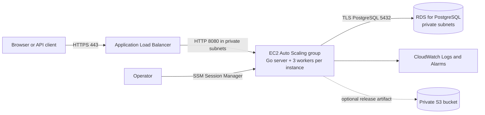

# AWS Deployment Plan

## 1. Goal and deployment shape

Deploy the existing Go service on Amazon EC2 and use PostgreSQL for the durable job store and shared work queue. Use **Amazon RDS for PostgreSQL** as the default AWS database choice. Amazon S3 is object storage; it is suitable for versioned release artifacts, exports, or archived files, but it cannot replace the live PostgreSQL database. The dashboard is embedded in the Go binary, so it does not need S3 or a CDN.

Production target:



For a private proof of concept, start with one EC2 instance and a non-production PostgreSQL database. Add the ALB and a multi-AZ EC2 Auto Scaling group before making the service public or relying on it for availability.

## 2. Current application facts and constraints

- `cmd/server/main.go` starts an HTTP server, three workers, and a PostgreSQL lease recovery loop in every process.
- `POST /jobs` accepts job requests; `GET /jobs/{id}` reads status. The embedded dashboard is served at `/`.
- `DATABASE_URL` is required; `PORT` is optional and defaults to `8080`.
- `README.md` documents the `jobs` table and its queued-job and expired-lease indexes. The application does not run schema migrations on startup.
- The service has no dedicated liveness/readiness endpoint, authentication, or metrics endpoint. `/` serving the dashboard does not prove PostgreSQL is reachable.
- Worker IDs currently repeat as `worker-1`, `worker-2`, and `worker-3` on every EC2 instance. Job attempt fencing protects ownership, but repeated IDs make logs and active-job attribution ambiguous.
- Job IDs are currently generated from `time.Now().UnixNano()`. Replace this with a collision-resistant ID generator before relying on concurrent public submission.
- Tests in `cmd/server` load the developer `.env` and use PostgreSQL. CI and pre-release tests must use a separate disposable test database, never the production database.
- The repository currently has no EC2 service unit, container image, CI release pipeline, or AWS infrastructure-as-code configuration.

## 3. AWS resources

### Required for production

1. **VPC spanning at least two Availability Zones.** Create public subnets for the load balancer and private subnets for EC2 and RDS. Attach an Internet Gateway to the VPC for public ALB ingress. Keep the database off the public internet. Decide how private EC2 instances reach AWS APIs and download releases: use NAT egress or the needed VPC endpoints (for example S3 gateway and interface endpoints for SSM, CloudWatch, and Secrets Manager). Restrict outbound access to what deployment and runtime require.
2. **RDS for PostgreSQL.** Use a supported PostgreSQL version compatible with the project and its `pgx` driver. Enable encryption at rest, automated backups, and point-in-time recovery. Use Multi-AZ for production availability; a single-AZ database is acceptable only for a disposable development environment.
3. **EC2 Auto Scaling group and launch template.** Place instances in private subnets. Start with desired capacity 2 and minimum capacity 2 for production; choose a maximum only after load and database connection capacity are measured. Each instance runs the same Go binary and participates in the shared PostgreSQL queue.
4. **Application Load Balancer.** Give it public subnets and an HTTPS listener using an AWS Certificate Manager certificate. Redirect HTTP port 80 to HTTPS. Forward traffic to the private EC2 targets on port 8080. If using a custom hostname, create the corresponding DNS record (for example, an alias in Route 53) after the certificate is issued.
5. **Security groups.**
   - ALB: allow inbound HTTPS from the intended clients. Allow HTTP only if it redirects to HTTPS.
   - EC2: allow port 8080 only from the ALB security group. Do not expose SSH to the internet; use Systems Manager Session Manager.
   - RDS: allow port 5432 only from the EC2 application security group.
6. **IAM instance profile.** Grant only what the running instance requires, such as reading its specific database secret, downloading a release artifact from a specific S3 prefix, and publishing logs/metrics. Do not put AWS access keys on the instance.
7. **CloudWatch Logs and alarms.** Collect application/system logs and alert on unhealthy targets, EC2 CPU, memory/disk (using the CloudWatch Agent for guest metrics), RDS availability/storage/connections, and job backlog/failure signals.

### Optional supporting resource

Create a private S3 bucket if releases or database exports need durable storage. Block public access, enable encryption and versioning, scope instance access to specific prefixes, and define lifecycle/retention rules. S3 is not in the current job read/write path; it would become part of that path if file-processing job types are implemented. The embedded dashboard is delivered by the server binary.

Use Terraform or CloudFormation to define the VPC, subnets, security groups, database, load balancer, instance profile, launch template, Auto Scaling group, alarms, and bucket policy. Keep infrastructure changes reviewed and repeatable; do not build production infrastructure only through undocumented console clicks.

## 4. Application changes required before public production

Complete these code changes before public exposure:

1. **Authentication and abuse controls:** protect job creation and lookups with an appropriate identity mechanism. For a browser-only internal tool, an ALB authentication integration can be considered; for API clients, define API authentication. Add request rate limits and a maximum request body size. Until this is implemented, restrict access to a VPN or explicitly trusted IP ranges.
2. **Health endpoints:** add a liveness endpoint that checks the process and a readiness endpoint that performs a short, bounded PostgreSQL ping. Configure the ALB target group to use readiness. Ensure a database outage does not cause an uncontrolled replacement loop; decide whether to fail readiness or keep instances registered during database maintenance.
3. **Unique worker identity:** include the instance identity/hostname and worker slot in worker IDs. Keep the attempt number as the fencing token. Emit the instance ID in startup, claim, completion, retry, and recovery logs.
4. **Configurable worker count and database pool:** make workers per instance and the `pgxpool` maximum connection count configurable. Calculate the total connection budget across all EC2 instances plus deployment, migration, monitoring, and administrative clients, and leave database headroom. Each added EC2 instance currently adds three worker pollers; workers poll frequently, so scale only after observing RDS load.
5. **Collision-resistant job IDs:** replace nanosecond timestamp IDs with UUIDs or another collision-resistant identifier. Preserve the existing string database column/API format unless an API version change is deliberately planned.
6. **Operational logging:** treat client disconnects (`context.Canceled`) as expected request cancellations rather than application errors. Include request IDs and host/instance identity in logs. Do not log credentials or full database URLs.
7. **HTTP timeouts:** retain the existing read-header timeout and set suitable read, write, and idle timeouts after confirming job submission/status handlers’ behavior. TLS should terminate at the ALB; only accept instance traffic from that ALB over the private network.
8. **Database migrations:** move the README schema into versioned SQL migrations and run migrations as a controlled deployment step, once per release, before new app instances become healthy. Do not let every application instance race to apply schema changes at startup. Use a restricted runtime database user that has only the permissions needed by the application.

Record that `failed` jobs currently expose status/retry data but not a durable failure message; decide whether storing a safe failure reason is required for operations.

### Possible richer job types for the project

The current addition and multiplication jobs are small demonstrations. These are useful next job types because they exercise longer-running work, validation, retries, and durable artifacts. They are **proposals, not implemented features**:

1. **Image processing:** accept an image from a private S3 input location, validate its format and size, generate a resized image and thumbnail (or convert it to a selected format), then store the outputs and dimensions/file sizes in S3 and the job result. Keep input and output object keys in the job payload/result; avoid storing image bytes in PostgreSQL. Set upload and output size limits, and use generated object keys rather than trusting user-supplied paths.
2. **Log analysis:** accept a log file from a private S3 input location, parse records, count errors by severity/time window, and produce a summary report (for example JSON or CSV) in S3. Return summary counts and the report object key through job status. Define supported formats and malformed-line behavior, and cap file size and processing time.

Both features need an API contract for submitting an input object reference and selecting options, authorization preventing users from reading or overwriting another user's objects, and a result schema that can represent structured data plus artifact references. Add S3 IAM permissions scoped separately to input and output prefixes. Upload files directly to S3 (for example through short-lived presigned URLs) rather than sending large bodies through the job API. PostgreSQL remains the source of truth for job state and coordination; S3 holds the file artifacts. Implement these only after the base deployment hardening, and add focused tests for parsing/transformation, failure/retry behavior, and object access without requiring production AWS resources.

## 5. Database provisioning and configuration

1. Create the RDS PostgreSQL instance in private DB subnets, with encryption and automated backups enabled. Set a backup retention period that meets the recovery objective, then test restoring a snapshot or point-in-time recovery into a separate instance.
2. Create the application database and separate migration/admin credentials from the runtime application user.
3. Apply the current schema and indexes from `README.md` through the first migration. Verify that PostgreSQL accepts the status values and column types the application uses.
4. Store the runtime connection string in AWS Secrets Manager or Systems Manager Parameter Store as a secure value. The current Go program only reads `DATABASE_URL` from the process environment; either securely inject that variable at launch (for example, through a root-owned environment file populated by a tightly scoped bootstrap) or add an explicit AWS secret retrieval integration. Do not assume the current binary retrieves Secrets Manager values by itself.
5. Use TLS for the application-to-RDS connection. Configure the RDS CA bundle and a verified SSL mode in `DATABASE_URL`; avoid `sslmode=disable` outside local development. AWS documents TLS support and certificate verification for RDS PostgreSQL.
6. Verify connectivity from a private EC2 test instance using the RDS endpoint, app security group, runtime database user, and TLS settings. Do not open RDS to `0.0.0.0/0`.
7. Set an explicit connection budget for `pgxpool` and test startup and database outage behavior. Do not point staging at the production database.

Example connection-string shape (substitute values securely; URL-encode special characters in credentials):

```text
postgres://<runtime-user>:<encoded-password>@<rds-endpoint>:5432/<database>?sslmode=verify-full&sslrootcert=/etc/ssl/certs/rds-ca-bundle.pem
```

## 6. Build and instance setup

1. Build and test in CI using the Go version required by `go.mod` (`go 1.27.1`). Build for the target EC2 architecture; for x86-64:

   ```sh
   GOOS=linux GOARCH=amd64 CGO_ENABLED=0 go build -trimpath -o job-server ./cmd/server
   ```

   For Graviton/ARM instances, build with `GOARCH=arm64` and test that artifact on the same architecture.
2. Run the unit and integration suite against an isolated PostgreSQL service. Update tests so they use a clearly named test `DATABASE_URL` and do not require or silently load a developer `.env` file. Include the multi-instance scenario: unique submissions, exactly one accepted claim per attempt, completion, retries, expired lease recovery, and SIGTERM shutdown.
3. Publish a versioned binary and checksum to a private release location (S3 is suitable) or bake it into a reviewed AMI. Keep the binary, migration version, and source revision associated with each release.
4. Configure EC2 with a supported Linux image, patched packages, minimal EBS storage, time synchronization, and the instance profile. Store no job state on EBS; PostgreSQL is authoritative.
5. Install a `systemd` unit (or equivalent supervisor) that starts the binary on boot, supplies `PORT=8080` and `DATABASE_URL`, restarts on unexpected exit, sends SIGTERM on stop, and writes stdout/stderr to journald/CloudWatch. Set `TimeoutStopSec` longer than the application's graceful shutdown window and verify shutdown under active work.
6. Use SSM Session Manager for administration. Restrict operator IAM permissions and record administrative changes.

## 7. Deployment sequence

1. Create and review the AWS infrastructure as code in a dedicated environment/account or clearly separated staging environment.
2. Provision RDS, network rules, the runtime DB user, secret, and backup policy.
3. Apply schema migrations once and verify them.
4. Deploy one private EC2 instance with the release artifact and service unit. Confirm it connects to RDS, starts three (or configured) workers, starts lease recovery, and serves the dashboard/API locally through an SSH tunnel or private test route.
5. Add health endpoints and authentication before public ingress. Configure ALB HTTPS and a target group health check against the readiness endpoint. Register one instance and confirm the target becomes healthy.
6. Smoke test the deployed service: load `/`, submit each supported job type, fetch each ID until terminal state, verify result/status, validate bad input, simulate retry behavior, and confirm no duplicate execution/completion under concurrent workers.
7. Increase the Auto Scaling group to at least two instances across Availability Zones. Submit a batch of jobs and verify all complete, one attempt is accepted per claim, stale attempts cannot update state, and logs identify which instance/worker processed each attempt.
8. Test rolling deployment and rollback: drain/replace targets, send SIGTERM, confirm in-flight work is either completed or safely recovered after lease expiry, and restore the prior known-good binary if health checks fail.
9. Run a restore drill and verify database backups can restore the `jobs` table and indexes. Document who can initiate recovery and the acceptable data-loss/time objectives.
10. Only after staging passes, deploy production with a gradual rollout and monitor the alarms below.

## 8. Scaling and operations

- The app instances are stateless with respect to jobs; PostgreSQL coordinates workers across instances. The dashboard’s job-history list is browser-local and is not a server-wide job listing.
- Add an ALB and Auto Scaling group when HTTP availability or multi-instance deployment is needed. AWS Auto Scaling can register/deregister instances with an attached target group and can use load-balancer health checks to replace unhealthy instances.
- ALB request count alone may not represent background queue pressure. Before automatic worker scaling, measure queued-job count, oldest queued-job age, processing count, expired leases, failure/retry rate, and RDS load. Publish deliberate CloudWatch custom metrics or use a private monitoring query; the application currently exposes no metrics endpoint.
- Scale the application and worker count while watching RDS CPU, storage, connections, query latency, and lock contention. Consider RDS Proxy only if measured connection churn/connection volume justifies another component; it is not required for the initial deployment.
- Keep RDS backups and S3 artifact retention independent. S3 can store exports and, if the proposed file-processing jobs are implemented, their input/output artifacts. Database restore should use RDS snapshots/automated backups unless a separate export workflow is deliberately designed.
- Maintain tested procedures for OS patching, Go releases, secret rotation, certificate renewal, database upgrades, incident response, and rollback.

## 9. Cost and capacity controls

- Choose the AWS Region and instance/database classes from measured workload and latency needs; this plan intentionally does not assume a price or workload size.
- Use the AWS Pricing Calculator before provisioning. Include EC2 instances/EBS, RDS storage and Multi-AZ, ALB hourly and traffic charges, NAT gateways or VPC endpoints, CloudWatch ingestion/retention, S3 storage/requests, snapshots, and data transfer.
- A private proof of concept can use one EC2 and single-AZ non-production PostgreSQL without an ALB. Do not mistake that lower-cost shape for high availability.
- Configure AWS Budgets and billing alerts before load testing. Define log retention and S3 lifecycle rules so test traffic and verbose logs do not accumulate indefinitely.
- Keep a dedicated staging database and cap test batch sizes. The test suite and multi-server experiments write job rows; do not point them at production data.
- Increase EC2 capacity only with measurements. Because every instance launches three workers today, multiplying EC2 instances also multiplies database pollers and database connections.

## 10. Security and reliability checklist

- [ ] No `.env`, credentials, database URL, or AWS access keys in source control, AMI logs, user data output, or release artifacts.
- [ ] EC2 and RDS are private; inbound rules follow ALB-to-EC2 and EC2-to-RDS security-group references.
- [ ] HTTPS is enforced at the public entry point; application-to-RDS TLS verifies the server certificate.
- [ ] Public job submission is authenticated and rate-limited, or ingress is limited to a trusted private network.
- [ ] Runtime DB role is not the RDS master user; it has only required table privileges.
- [ ] RDS encryption, backup retention, monitoring, and restoration are tested.
- [ ] Health checks represent app readiness and are safe during database maintenance.
- [ ] Worker IDs are unique per instance; worker count and pool size are explicitly configured.
- [ ] IDs are collision-resistant; request size and HTTP timeouts are bounded.
- [ ] Logs identify release, request, instance, worker, job ID, and attempt without exposing secrets.
- [ ] Alarms cover unhealthy targets, low healthy-host count, RDS failure/capacity, queue age, retries, and failed jobs.
- [ ] Deployment and shutdown/lease recovery are tested before increasing production capacity.

## 11. AWS documentation

- [Amazon S3: object storage and buckets](https://docs.aws.amazon.com/AmazonS3/latest/userguide/Welcome.html)
- [Amazon RDS for PostgreSQL](https://docs.aws.amazon.com/AmazonRDS/latest/UserGuide/CHAP_PostgreSQL.html)
- [RDS PostgreSQL SSL/TLS](https://docs.aws.amazon.com/AmazonRDS/latest/UserGuide/PostgreSQL.Concepts.General.SSL.html)
- [Secrets Manager: retrieving secrets](https://docs.aws.amazon.com/secretsmanager/latest/userguide/retrieving-secrets.html)
- [Application Load Balancer target health checks](https://docs.aws.amazon.com/elasticloadbalancing/latest/application/target-group-health-checks.html)
- [Attach a load balancer to an EC2 Auto Scaling group](https://docs.aws.amazon.com/autoscaling/ec2/userguide/autoscaling-load-balancer.html)
- [RDS backup and point-in-time recovery](https://docs.aws.amazon.com/AmazonRDS/latest/gettingstartedguide/managing-backup-restore.html)
